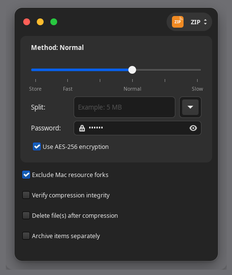
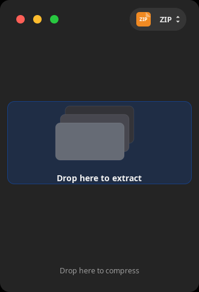
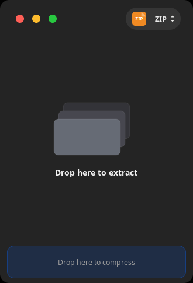
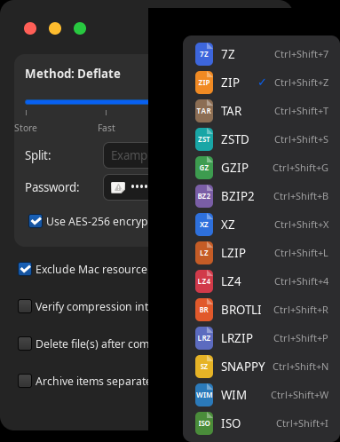
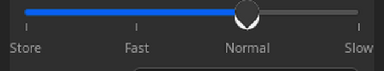

# Elavo Archive Utility

Archive Utility compresses files and extracts archives on the Linux desktop. The window opens on the options for the format in the pill at the top right. Drag files over it and the upper area extracts, the lower area compresses.

It is the Elavo desktop's archiver. The colours, type, corner radii, and controls follow the other Elavo apps (16px window, 12px cards, pill buttons, Roboto).







## What it does

- Create 7Z, ZIP, TAR, Zstandard, Gzip, Bzip2, XZ, Lzip, LZ4, Brotli, LRZIP, Snappy, WIM, and ISO. A folder or several files packed with a single-file compressor become a tar archive of that compressor (`notes.tar.zst`, `notes.tar.gz`, and so on).
- DMG is offered only when `dmg` from libdmg-hfsplus is installed. AAR is not offered: there is no free creator for it beyond ZIP.
- Extract those, plus RAR, EXE installers, MSI, CAB, LZH/LHA, ARJ, CPIO, RPM, DEB, XAR/PKG, AR, CHM, compress (`.Z`), LZMA, SquashFS, VHD/VHDX, VMDK, QCOW2, APK, JAR, and IPA. HFS+ and APFS images are opened when 7-Zip recognises them.
- A file Archive Utility does not recognise is handed to 7-Zip before it is refused.
- Each format is created only when its tool is installed or built in. A missing tool is a grey row with “Install … to create …” and the same sentence if you try anyway.
- Password for 7Z and ZIP. 7-Zip is told `-p` with no password and reads the password from its prompt on standard input, so the password is not an argument. `unar` reads its prompt from the terminal, so Archive Utility types it on a private pseudoterminal. The password is never saved.
- ZIP can use AES-256 when a password is set. 7Z can also encrypt file names (Preferences).
- Level has six stops. The method line reads No compression, Fastest, less compression, Fast, less compression, Normal, Slow, more compression, or Slowest, more compression. Store, Fast, Normal, and Slow label stops 1, 2, 4, and 6; stops 3 and 5 are dots. Split is empty for one file. A size you type (`5 MB`, `700MB`, `1.5 GB`, `512 KB`, or a bare byte count) or a preset from the menu sets the part size. Preset bytes: floppy 1,457,664; 650 MB CD 681,574,400; 700 MB CD 734,003,200; DVD-5 4,700,372,992; DVD-9 8,543,666,176; BD-25 25,025,314,816; BD-50 50,050,629,632; BD-XL 100,103,356,416; FAT32 4,294,967,295.
- Exclude Mac resource forks (`.DS_Store`, `._*`, `__MACOSX`), verify the archive after writing it, delete the originals after a successful archive, and archive each item separately. These are remembered per format.
- A progress view with Cancel, and a preferences window for where archives go, the new-folder rule, name conflicts, and opening the folder when finished.
- A `.desktop` file and MIME types so a file manager can offer Archive Utility under Open With. Opening an archive that way, or starting Archive Utility with archive paths, shows a progress window instead of the main window: one row per archive, extracted beside the archive (or into the folder from Preferences). A second open adds a row to the same window. The window closes when every archive has finished; an error stays on its row. Launching with no files still opens the main window.
- Progress bars, the level slider, checks, and selection use the system accent from the settings portal, or Elavo's accent file when that is present. Elavo blue (`#0860f2`) is the fallback.





## Formats

| Format | Create | Extract | Notes |
| --- | --- | --- | --- |
| 7Z | 7-Zip | 7-Zip | Password, including file names. Split. |
| ZIP | 7-Zip, or Info-ZIP `zip` | 7-Zip, `unzip`, or bsdtar | Password. AES-256 is optional. Split needs 7-Zip. |
| TAR | built in | built in | |
| Zstandard, Gzip, Bzip2, XZ | built in | built in | One file, or tar for a folder. |
| Lzip | `lzip` | `lzip` | One file, or `tar.lz`. |
| LZ4 | `lz4` | `lz4` | One file, or `tar.lz4`. |
| Brotli | `brotli` | `brotli` | One file, or `tar.br`. |
| LRZIP | `lrzip` | `lrzip` | One file, or `tar.lrz`. |
| Snappy | built in | built in | Framed Snappy (`.sz`). |
| WIM | 7-Zip | 7-Zip | |
| ISO | `xorriso` or `genisoimage` | 7-Zip or bsdtar | |
| DMG | `dmg` from libdmg-hfsplus, if installed | 7-Zip | Hidden from the menu when no creator is installed. |
| RAR | | libunarr, then `unar`, then `unrar-free` | Passwords need `unar`. 7-Zip is not used. |
| EXE | | `innoextract`, then 7-Zip | Inno Setup when `innoextract` is present; NSIS and other self-extractors through 7-Zip. |
| MSI, CAB, LZH, ARJ, CPIO, RPM, XAR, AR, CHM, SquashFS, VHD, VMDK, QCOW | | 7-Zip | CAB also uses `cabextract` when 7-Zip is missing. |
| DEB | | `dpkg-deb`, 7-Zip, or bsdtar | |
| compress (`.Z`), LZMA | | `gzip`/`uncompress` or `xz`/`lzma`, then 7-Zip | |
| APK, JAR, IPA | | as ZIP | |

Opening `photos.7z.001` extracts the whole set. For a multi-part RAR, open the `.rar` or `.part1.rar` file.

Tar archives keep symbolic links. 7Z and ZIP store the file a link points at. Paths that leave the destination (`..` or an absolute path) are refused.

When bubblewrap is installed, external tools may write only inside a temporary folder. Archive Utility then moves the result into place.

## Build and run

You need Rust 1.85 or newer, GTK 4.14, and the compression libraries. The archive programs are runtime tools, not build dependencies. Tests that need a tool are skipped when it is missing, except the 7-Zip and ISO tests, which expect `7z` and `xorriso`.

### Debian, Ubuntu, and related

```sh
sudo apt install build-essential pkg-config libgtk-4-dev \
    liblzma-dev libbz2-dev zlib1g-dev libzstd-dev \
    7zip zstd lz4 brotli lzip lrzip libarchive-tools bubblewrap \
    xorriso cabextract innoextract libunarr1 fonts-roboto
cargo build --release
./target/release/elavo-archive-utility
```

`unar` is not in current Ubuntu archives. libunarr opens RAR archives that have no password. Install `unar` when you need RAR passwords.

### Fedora

```sh
sudo dnf install gcc pkgconf-pkg-config gtk4-devel \
    xz-devel bzip2-devel zlib-devel libzstd-devel \
    p7zip p7zip-plugins zstd lz4 brotli lzip lrzip bsdtar bubblewrap \
    xorriso cabextract innoextract
cargo build --release
```

On Fedora the 7-Zip package may be named `7zip` or `p7zip`. Archive Utility looks for `7zz`, `7z`, and `7za`.

### Arch

```sh
sudo pacman -S --needed base-devel gtk4 xz bzip2 zlib zstd p7zip lz4 brotli lzip lrzip libarchive bubblewrap libisoburn cabextract innoextract unar
cargo build --release
```

### Tests

```sh
cargo test
```

### Install for your user

```sh
./scripts/install.sh
```

That puts `elavo-archive-utility` on `~/.local/bin` and installs the desktop file, the AppStream metainfo, and the icons. Set `PREFIX` for a different location, for example `PREFIX=/usr/local`.

### Flatpak

`packaging/io.elavo.ArchiveUtility.flatpak.yml` builds Archive Utility, 7-Zip 25.01, libunarr 1.1.1, and cabextract 1.11 against the GNOME 47 runtime. `unar` is not included (it is a GNUstep program). `innoextract` is not included (it needs Boost). Both still work if they are on `PATH` outside the sandbox.

```sh
flatpak-builder --user --install --force-clean build-dir \
    packaging/io.elavo.ArchiveUtility.flatpak.yml
```

## Using it

Open Archive Utility and the window shows the options for the format in the pill. The chevron on the pill opens the format list. Drag files over the window and it changes to the drop targets: the upper area extracts, the lower area compresses. Letting go, or moving the pointer away, brings the options back. Dropping an archive on the upper area extracts it, including a file 7-Zip can open even when the name is unfamiliar. Ctrl+Shift and the letter in the list selects a format.

From a terminal:

```sh
elavo-archive-utility                              # the window
elavo-archive-utility ~/Photos                     # compress that folder
elavo-archive-utility ~/Photos.tar.gz              # extract it

elavo-archive-utility --batch compress --format tar.gz --level fast \
    --output trip.tar.gz ~/Photos
elavo-archive-utility --batch extract --output ~/Restored ~/Photos.tar.gz

elavo-archive-utility --batch compress --format 7z --password 'correct horse' \
    --encrypt-names --split 5MB --exclude-macos --verify \
    --output secret.7z ~/Photos
```

`--help` lists every option. Settings live in `$XDG_CONFIG_HOME/elavo-archive-utility/config.ini`, usually `~/.config/elavo-archive-utility/config.ini`. `ELAVO_ARCHIVE_UTILITY_CONFIG` points at a different file.

| Keys | Action |
| --- | --- |
| Ctrl+Shift+7, Z, T, S, G, B, X, L, 4, R, P, N, W, I | Choose 7Z, ZIP, TAR, ZSTD, GZIP, BZIP2, XZ, LZIP, LZ4, BROTLI, LRZIP, SNAPPY, WIM, ISO |
| Ctrl+Shift+D | DMG, when a free creator is installed |
| Escape | Cancel the job in progress |
| Ctrl+, | Preferences |
| Ctrl+W | Close the window |
| Ctrl+Q | Quit |

## Dependencies and licenses

Archive Utility itself is MIT. See [LICENSE](LICENSE). LGPL libraries are linked dynamically or loaded at runtime. GPL programs are separate processes and are never linked.

Built into the program:

| Piece | License | Role |
| --- | --- | --- |
| GTK 4, GLib, GIO, cairo, Pango, GDK | LGPL-2.1 | The window. Dynamically linked. |
| [tar](https://crates.io/crates/tar) | MIT OR Apache-2.0 | tar archives |
| [flate2](https://crates.io/crates/flate2) and miniz_oxide | MIT | gzip |
| [bzip2](https://crates.io/crates/bzip2) and libbz2 | MIT OR Apache-2.0, and the bzip2 license | bzip2. libbz2 is dynamically linked. |
| [xz2](https://crates.io/crates/xz2) and liblzma | MIT OR Apache-2.0, and 0BSD | xz. liblzma is dynamically linked. |
| [zstd](https://crates.io/crates/zstd) and libzstd | MIT, and BSD-3-Clause (libzstd is also offered as GPL-2.0; this project uses the BSD terms) | zstd. libzstd is dynamically linked. |
| [snap](https://crates.io/crates/snap) | BSD-3-Clause | framed Snappy |
| [tempfile](https://crates.io/crates/tempfile) | MIT OR Apache-2.0 | Temporary folders |
| [libc](https://crates.io/crates/libc) | MIT OR Apache-2.0 | Process groups, so Cancel can stop a tool |

Separate programs and libraries, used only when they are installed. They are not required to build Archive Utility:

| Program | License | Role |
| --- | --- | --- |
| 7-Zip (`7zz`, `7z`, or `7za`) | LGPL-2.1-or-later, with BSD-3-Clause and public-domain parts | Create and extract 7Z, ZIP, and WIM. Extract the disc, installer, and package formats in the table. |
| libunarr | LGPL-3.0-or-later | Extract RAR. Loaded with `dlopen` when `libunarr.so.1` is present. It does not read encrypted RAR archives. |
| unar and lsar, from The Unarchiver | LGPL-2.1-or-later | Extract RAR, including passwords. Preferred over libunarr when a password is set. |
| unrar-free | GPL-2.0-or-later | Optional RAR fallback when libunarr and `unar` are missing and the archive has no password. |
| Info-ZIP `zip` and `unzip` | Info-ZIP license (BSD-like) | ZIP without a password, when 7-Zip is not installed. |
| bsdtar, from libarchive | BSD-2-Clause | Fallback for tar, ZIP, ISO, AR, CPIO, XAR, and DEB. |
| lzip | GPL-2.0-or-later | Create and extract Lzip. |
| lz4 | BSD-2-Clause | Create and extract LZ4. |
| brotli | MIT | Create and extract Brotli. |
| lrzip | GPL-2.0-or-later | Create and extract LRZIP. |
| xz, lzma, gzip, compress | Public domain, GPL, or the gzip license, depending on the package | Extract `.lzma` and `.Z`. |
| cabextract | GPL-2.0-or-later | Extract CAB when 7-Zip is missing. |
| innoextract | Zlib, and it needs Boost (BSL-1.0) | Extract Inno Setup installers. |
| dpkg-deb | GPL-2.0-or-later | Extract DEB data files. |
| xorriso or genisoimage | GPL-2.0-or-later | Create ISO images. |
| dmg, from libdmg-hfsplus | GPL-2.0-or-later | Create DMG images. The menu omits DMG when it is not installed. |
| bubblewrap | LGPL-2.0-or-later | Optional. Limits where an external tool may write. |

7-Zip’s source tree includes an unRAR implementation whose license is not a free software license. Archive Utility does not ask 7-Zip to open RAR archives.

## What this version does not do

- It does not create RAR or AAR archives. The RAR compressor is not available under a free license, and AAR has no free creator beyond ZIP.
- It does not create DMG images unless `dmg` from libdmg-hfsplus is installed.
- It does not put a password on tar or the single-file compressors.
- It does not split those formats. Split applies to 7Z and ZIP.
- The Flatpak manifest does not include `unar` or `innoextract`.
- There is no plugin for a file manager’s context menu beyond the Open With entry from the desktop file.

## Layout

- `crates/elavo-archive-utility-core` packs and unpacks. It does not use GTK, and the tests live here.
- `crates/elavo-archive-utility` is the GTK application and the `--batch` commands.
- `data` holds the stylesheet, the icon, the desktop file, and the AppStream metainfo.
- `packaging` holds the Flatpak manifest.
